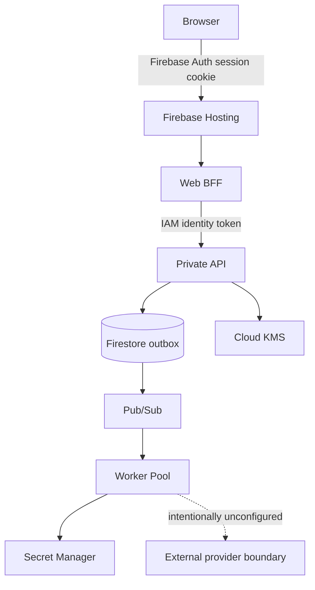
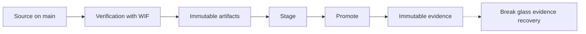

# BoundaryMesh

**Secure every system crossing.**

A successful HTTP request does not prove that one system should be allowed to exchange data or actions with another. BoundaryMesh sits in front of that exchange and asks one question: can this transaction cross this security boundary?

A system crossing is an untrusted payload leaving one trust domain and entering another. One example is a signed partner webhook that becomes a settlement instruction. BoundaryMesh checks identity, authorization, authenticity, freshness, and replay. It validates the integration contract and decides which fields may leave. The outcome is one of `ALLOW`, `ALLOW_WITH_TRANSFORMATION`, `QUARANTINE`, or `REJECT`. Allowed work becomes a delivery instruction, and the system records what it enforced.

This is not an API dashboard, an iPaaS product, an AI copilot, or a release board. It is a portfolio project in the BoundaryMesh development project on Google Cloud. It is not enterprise production, and it does not carry paid customer traffic.

## What I built

A Vue console, a Java and Spring API, and an Apache Camel worker, deployed on Google Cloud with Pulumi and keyless GitHub Actions.

The hosted path is Firebase Hosting, then an authenticated web BFF, then a private API, then Firestore and a transactional outbox, then Pub/Sub, then a Cloud Run worker pool. Cloud KMS signs exchange attestations. External connectors and production Microsoft Entra stay off on purpose. Local labs exercise the engine, HMAC webhooks, contract and egress checks, and one bounded Microsoft Graph calendar pull.

## Three surfaces

The hosted root is the public product. A recruiter opens the synthetic BoundaryMesh application immediately. It does not call the API, and it cannot change cloud state. Project context is an optional About panel inside that application. `/explore` redirects to `/`.

The operator console is a separate hosted page at `/operator`. Google sign in and a web edge session are required before any operator action. That page is not an anonymous demo.

The local lab console is what `npm run dev` serves in `frontend/`. It is the richer console on this machine. Its lab routes are not part of the hosted cloud build.

This source change reaches the live channel only through a later approved release.

## Architecture

More detail: [docs/ARCHITECTURE.md](docs/ARCHITECTURE.md).

## What is live

| Item | State |
| --- | --- |
| Portfolio GCP environment | Live, in Europe west 4 |
| API, web BFF, and worker | Promoted release, 100% traffic |
| Firebase Hosting | This repository root is the full BoundaryMesh console with synthetic data, and `/operator` remains the protected console. The source change reaches the live channel only through a later approved release |
| Pulumi | 83 managed resources, zero drift |
| Promotion evidence | Verified and immutable |
| Rollback | Implemented, with preserved targets. Not executed against the live environment |
| Compute Engine API | Disabled on purpose |

The public page explains the project. It is not a public SaaS product, and it is not anonymous access to operator actions. Revision names and the frozen release identity are in [docs/CI_CD.md](docs/CI_CD.md).

## Engineering highlights

- Vue 3 console, Java 25 and Spring Boot API, separate Camel worker
- Firebase Hosting to a web BFF to a private Cloud Run API
- Firestore outbox to Pub/Sub to a Cloud Run worker pool
- Pulumi owns the infrastructure (83 resources). Continuous delivery owns the image, revision, and traffic
- GitHub Actions reaches GCP through Workload Identity Federation. Seven exact contexts. CI, deploy, and workload service accounts have no keys managed by users
- Release artifacts are immutable and pinned to a digest. SBOM and provenance are published and unsigned
- Cloud KMS signs exchange attestations. That is enforcement proof, not artifact signing
- A person starts stage and promote. A separate break glass workflow can restore missing promotion evidence. It cannot promote again
- Rollback exists and its targets are preserved. It has not been run against live traffic

## Tech stack

| Area | In use |
| --- | --- |
| Frontend | Vue 3, TypeScript, Pinia, Vue Router, Vite, SCSS |
| Backend | Java 25, Spring Boot 4.1, Spring Security, Apache Camel 4.22, Resilience4j |
| Cloud | Cloud Run (API, BFF, and worker pool), Firebase Hosting, Artifact Registry |
| Data and messaging | Firestore, Pub/Sub, Secret Manager, Cloud KMS |
| Infrastructure and delivery | Pulumi TypeScript, GitHub Actions, Workload Identity Federation |
| Security | Firebase Auth and a BFF session, HMAC, JWT and JWKS, private API |
| Testing | JUnit, Spring Security tests, Camel and WireMock, Vitest, Playwright |

Version pins: [docs/INFRASTRUCTURE.md](docs/INFRASTRUCTURE.md). OpenTelemetry, Cosign, ZAP, and Dependabot are not in this repository.

## How a crossing moves

1. An untrusted transaction arrives through a local lab, an HMAC webhook, or the hosted synthetic operator path.
2. The API checks identity, authorization, authenticity, freshness, replay, contract, and egress.
3. `REJECT` stops and keeps evidence only. `QUARANTINE` holds the work for an operator. `ALLOW` and `ALLOW_WITH_TRANSFORMATION` emit a `DeliveryInstruction`.
4. The hosted API writes that instruction to a Firestore outbox and publishes it to Pub/Sub.
5. The worker consumes the event, may resolve one named secret, and runs Camel only after the policy decision.
6. A finished crossing writes a SHA256 audit chain and an exchange attestation signed by Cloud KMS.

The hosted check was one synthetic browser transaction through that internal path. There is no live fan out to third party connectors. Graph change notifications are not implemented.

## Security and delivery

GitHub Actions authenticates to GCP with Workload Identity Federation. The CI, deploy, and workload service accounts have no keys managed by users. The core API is private behind the web BFF. A deployment consumes a release artifact that is already pinned to a digest. It does not rebuild the image.

Promotion evidence is written only when the promotion completed. If that record is missing, a separate keyless workflow can publish it. That workflow cannot promote, roll back, or redeploy. Detail: [docs/CI_CD.md](docs/CI_CD.md) and [docs/SECURITY.md](docs/SECURITY.md).

## Testing

The suites below were not run as one combined total. Do not add the counts together.

| Suite | Evidence |
| --- | --- |
| Backend (Maven and JUnit) | 387 tests in the default verify |
| Frontend (Vitest) | 63 tests |
| Infrastructure | 47 tests |
| Deploy scripts | 115 tests |
| Playwright | 15 tests in the repo. They were not run again for the documentation freeze |

Coverage includes domain decisions, Spring Security slices, Camel routes, Resilience4j, contract and egress fixtures, and Vue view models. The default `mvnw verify` does not include the optional GCP emulator or live groups.

Known findings, not hidden: oxlint notes in test mocks, frontend transitive npm audit findings on the Firebase and `@grpc` path, and three transitive findings in infra. The deploy script audit is clean. This repository does not claim zero vulnerabilities. See [docs/SECURITY.md](docs/SECURITY.md).

## Repository guide

| Path | What it is |
| --- | --- |
| [`backend/`](backend/) | Java modules: domain, API, web BFF, worker, GCP adapters |
| [`frontend/`](frontend/) | Vue 3 lab console locally, and the hosted public page plus operator console |
| [`infra/`](infra/) | Pulumi TypeScript for the BoundaryMesh development project |
| [`contracts/`](contracts/) | OpenAPI, AsyncAPI, JSON Schema, and release evidence schemas |
| [`scripts/deploy/`](scripts/deploy/) | Publish, stage, promote, rollback, and evidence recovery |
| [`docs/`](docs/) | Architecture, security, delivery, and local development |

## Where to read next

- [docs/README.md](docs/README.md) for the documentation map
- [docs/ARCHITECTURE.md](docs/ARCHITECTURE.md) for topology
- [docs/SECURITY.md](docs/SECURITY.md) for controls and gaps
- [docs/CI_CD.md](docs/CI_CD.md) for publish, stage, promote, and recovery
- [docs/INFRASTRUCTURE.md](docs/INFRASTRUCTURE.md) for Pulumi and what delivery owns
- [docs/LOCAL_DEVELOPMENT.md](docs/LOCAL_DEVELOPMENT.md) for how to run it locally

## What this project does not claim

The repository supports full stack work, cloud engineering, API design, one internal event path, infrastructure as code, delivery automation, and real security boundaries.

It does not support these claims:

- Anonymous use of the operator console, or paid production
- A live rollback that has already succeeded
- A signed software supply chain, or Cosign
- OpenTelemetry, Cloud Trace, or production alerts
- Enterprise Graph notifications, or hosted Entra
- Application CI that runs on every pull request
- A complete application security scanning pipeline
- "All human access is keyless." Workstation credentials exist
- Zero trust, a fully hardened platform, or complete observability

Optional later work, not part of the current system: [docs/PRODUCT.md](docs/PRODUCT.md).

## Local development

You need JDK 25 and Node 22. Do not commit secrets. Commands: [docs/LOCAL_DEVELOPMENT.md](docs/LOCAL_DEVELOPMENT.md).
