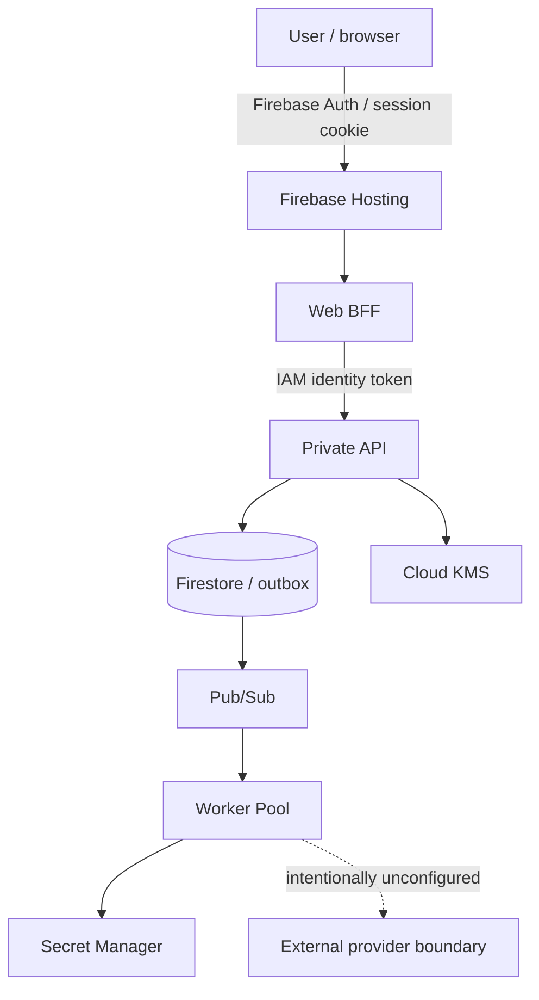
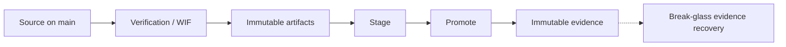

# BoundaryMesh

**Secure every system crossing.**

A successful HTTP request does not prove that one system should be allowed to exchange data or actions with another. BoundaryMesh is a **cross-system security enforcement layer**: it sits in front of an integration and answers one question — **can this transaction cross this security boundary?**

A *system crossing* is an untrusted payload leaving one trust domain and entering another (for example a signed partner webhook becoming a settlement instruction). BoundaryMesh authenticates identity, authorizes the action, checks authenticity, freshness and replay, validates the integration contract, governs which fields may leave, then enforces a deterministic outcome: `ALLOW`, `ALLOW_WITH_TRANSFORMATION`, `QUARANTINE`, or `REJECT`. Allowed work becomes a delivery instruction. Evidence of what was enforced is recorded.

It is **not** an API dashboard, an iPaaS clone, an AI copilot, or a release-intelligence product. It is portfolio engineering in a GCP `dev` project — not enterprise production and not paid customer traffic.

## What I built

A full-stack enforcement product with a Vue console, a Java/Spring API, and a Camel worker, deployed to Google Cloud with Pulumi and keyless GitHub Actions.

The hosted path is Firebase Hosting → authenticated Web BFF → IAM-private API → Firestore / outbox → Pub/Sub → Cloud Run Worker Pool, with Cloud KMS signing exchange attestations. External connectors and production Microsoft Entra remain intentionally disabled. Local labs prove the engine, HMAC webhooks, contract/egress firewalled crossings, and a bounded Graph calendar pull.

## Architecture

Deeper design: [docs/ARCHITECTURE.md](docs/ARCHITECTURE.md).

## Live / verified status

| Item | State |
| --- | --- |
| Portfolio/dev GCP environment | **LIVE** (`boundarymesh-dev`, `europe-west4`) |
| API / Web BFF / Worker | Promoted staged release, 100% traffic |
| Firebase Hosting | Live SPA; operator sign-in required |
| Pulumi | 83 managed / zero drift |
| Delivery | Promotion evidence verified and immutable |
| Rollback | Implemented, targets preserved; **not live-executed** |
| Compute Engine API | Disabled intentionally |

This is not a public recruiter demo and not a public production SaaS. The hosted UI is an operator console. Walk through the product locally (below). Current inventory: [PROJECT_STATUS.md](PROJECT_STATUS.md).

## Engineering highlights

- Vue 3 console and Java 25 / Spring Boot API with a separate Camel worker
- Firebase Hosting → Web BFF → IAM-private Cloud Run API
- Firestore transactional outbox → Pub/Sub → Cloud Run Worker Pool
- Pulumi-managed GCP (83 resources); CD owns image, revision, and traffic
- Keyless GitHub Actions via Workload Identity Federation (7 exact contexts; no user-managed keys on CI/CD or workload accounts)
- Immutable, digest-pinned artifacts with published **unsigned** SBOM and provenance
- Cloud KMS–backed exchange attestations (enforcement proof, not artifact signing)
- Human-gated stage / promote; fail-closed break-glass evidence recovery
- Rollback workflows and preserved targets — **not exercised against live traffic**

## Tech stack

| Area | In use |
| --- | --- |
| Frontend | Vue 3, TypeScript, Pinia, Vue Router, Vite, SCSS |
| Backend | Java 25, Spring Boot 4.1, Spring Security, Apache Camel 4.22, Resilience4j |
| Cloud | Cloud Run (API + BFF + Worker Pool), Firebase Hosting, Artifact Registry |
| Data & messaging | Firestore, Pub/Sub, Secret Manager, Cloud KMS |
| Infrastructure / delivery | Pulumi TypeScript, GitHub Actions, Workload Identity Federation |
| Security | Firebase Auth + BFF session, HMAC, JWT/JWKS, IAM-private API |
| Testing | JUnit, Spring Security tests, Camel/WireMock, Vitest, Playwright |

Pins: [docs/STACK.md](docs/STACK.md). OpenTelemetry, Cosign, ZAP, and Dependabot are **not** in this repository.

## How the system works

1. An untrusted transaction arrives (local lab, HMAC webhook, or hosted synthetic operator path).
2. The API runs identity, authorization, authenticity, freshness, replay, contract, and egress controls.
3. `REJECT` stops with evidence only. `QUARANTINE` holds work for an operator. `ALLOW` / `ALLOW_WITH_TRANSFORMATION` emit a `DeliveryInstruction`.
4. Production persists the instruction in a Firestore outbox and publishes to Pub/Sub.
5. The worker consumes the event, may resolve a named secret, and runs Camel **after** the policy decision.
6. Terminal outcomes write a SHA-256 audit chain and a KMS-signed exchange attestation.

Hosted verification used one synthetic browser-origin transaction through that internal path. **No live third-party connector fan-out.** Graph change notifications are not implemented.

## Security and delivery model

GitHub Actions authenticates to GCP through Workload Identity Federation. CI, deploy, and workload service accounts have **no user-managed keys**. The core API is IAM-private behind the Web BFF. Deployments consume immutable digest-pinned release artifacts.

Promotion evidence is fail-closed. A separate keyless workflow can recover **missing evidence only** after a successful promotion — it cannot promote, roll back, or redeploy. Details: [docs/CI_CD.md](docs/CI_CD.md), [docs/APPLICATION_SECURITY.md](docs/APPLICATION_SECURITY.md).

## Testing

Suites are separate; do not add them into one marketing total.

| Suite | Evidence |
| --- | --- |
| Backend (Maven / JUnit) | 387 tests in the default verify |
| Frontend (Vitest) | 63 tests |
| Infrastructure (Pulumi unit) | 47 tests |
| Deploy scripts | 115 tests |
| Playwright | 15 tests present (local Java + Vite; not re-run in the documentation freeze) |

Types covered: domain decisions, Spring Security slices, Camel routes and Resilience4j, contract/egress fixtures, Vue view-models. Opt-in GCP emulator/live groups are not part of default `mvnw verify`.

Known polish: oxlint findings in test mocks; frontend transitive npm audit issues on the Firebase/@grpc path; infra transitive audit findings. Deploy audit is clean. **No claim of zero vulnerabilities.** See [docs/APPLICATION_SECURITY.md](docs/APPLICATION_SECURITY.md).

## Repository guide

| Path | What it is |
| --- | --- |
| [`backend/`](backend/) | Java modules: domain, API, Web BFF, worker, GCP adapters |
| [`frontend/`](frontend/) | Vue 3 console (local labs) and hosted operator SPA |
| [`infra/`](infra/) | Pulumi TypeScript for `boundarymesh-dev` |
| [`contracts/`](contracts/) | OpenAPI, AsyncAPI, JSON Schema, release/evidence schemas |
| [`scripts/deploy/`](scripts/deploy/) | Publication, stage, promote, rollback, evidence recovery |
| [`docs/`](docs/) | Current architecture/security/CI docs; `PHASE_*` files are history |

## Trusted docs

Start here, not in phase notes:

- [PROJECT_STATUS.md](PROJECT_STATUS.md) — what is live
- [docs/ARCHITECTURE.md](docs/ARCHITECTURE.md) — topology
- [docs/CI_CD.md](docs/CI_CD.md) — WIF, stage, promote, recovery
- [docs/APPLICATION_SECURITY.md](docs/APPLICATION_SECURITY.md) — controls and gaps
- [docs/PULUMI.md](docs/PULUMI.md) — IaC and fenced CD fields
- [docs/README.md](docs/README.md) — documentation map
- [CV_CLAIMS_MATRIX.md](CV_CLAIMS_MATRIX.md) — what is safe to say on a CV
- [docs/LOCAL_DEVELOPMENT.md](docs/LOCAL_DEVELOPMENT.md) — how to run locally

## Scope and honest limitations

Safe to infer from this repo: full-stack implementation, cloud engineering, API design, an internal event-driven path, IaC, CI/CD, security boundaries, and production-style deployment discipline.

**Not claimed**

- Public recruiter demo or paid production
- Live rollback success
- Signed software supply chain / Cosign
- OpenTelemetry, Cloud Trace, or production alerts
- Enterprise Graph notifications or hosted Entra
- Fully automated application CI on pull requests
- Complete AppSec scanning (no SAST/DAST in CI)
- “All human access is keyless” (workstation ADC exists)
- Zero-trust / fully hardened / complete observability

Optional follow-ups (not CV blockers): [docs/ROADMAP.md](docs/ROADMAP.md).

## Local development

Requires **JDK 25** and **Node 22**. No secrets in Git. Commands: [docs/LOCAL_DEVELOPMENT.md](docs/LOCAL_DEVELOPMENT.md).
