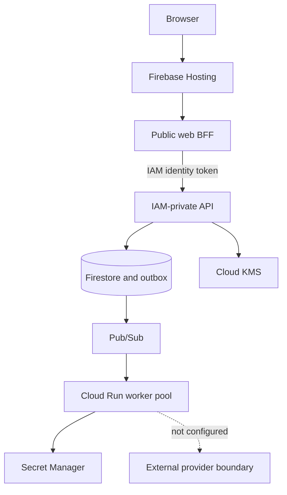

# Architecture

BoundaryMesh is a Cloud Run API, a public web edge, and a Cloud Run worker pool. One Java engine decides whether a transaction may cross a boundary. Apache Camel runs only after that decision, and only on the worker.

## Stack

| Area | Choice |
| --- | --- |
| Frontend | Vue 3, TypeScript, Pinia, Vue Router, Vite |
| Backend | Java 25, Spring Boot 4.1.1, Spring Security 7.1 |
| Integration runtime | Apache Camel 4.22 on the worker |
| Cloud | Google Cloud, `europe-west4` |
| Compute | Cloud Run service for the API and web edge; Cloud Run worker pool for delivery |
| Data | Firestore Native |
| Messaging | Pub/Sub. A dead-letter topic exists. Dead-letter forwarding is not configured |
| Secrets | Secret Manager. Firestore stores references, not secret values |
| Signatures | Cloud KMS ECDSA P-256 for exchange attestations |
| Infrastructure | Pulumi TypeScript, state in Cloud Storage, secrets in Cloud KMS |
| CI identity | GitHub Actions to Google Cloud through Workload Identity Federation |
| Hosted operator identity | Firebase Google sign-in and a web edge session |
| Microsoft connector | Local Entra session and one Graph calendar pull. Production Entra is disabled |
| AI | None. Policy is deterministic |

## Request path



Firebase Hosting serves the static application and rewrites session and API paths to `boundarymesh-web`. That web edge is the only internet-facing application process. It calls the IAM-private API with a service identity token. The API runs the enforcement engine. `REJECT` records evidence and does not create a delivery instruction. `QUARANTINE` records a quarantine item and does not start Camel. `ALLOW` and `ALLOW_WITH_TRANSFORMATION` write a delivery instruction for the approved payload only.

In the hosted profile that instruction goes through a transactional outbox to Pub/Sub. The worker pool has no HTTP ingress. It pulls the subscription, resolves a connector secret only when a destination is configured, and runs Camel with Resilience4j around outbound HTTP. Hosted connector endpoints are empty on purpose. The verified hosted transaction ended in durable quarantine and acknowledgement without calling an external provider and without reading a connector secret.

## Why this is not an API gateway

A gateway can authenticate a caller and proxy the original request. BoundaryMesh ends the untrusted transaction, runs typed controls, and may transform or hold the payload. The destination receives a normalized delivery instruction. It does not receive the raw request. That instruction is described by AsyncAPI.

## Service boundaries

### `boundarymesh-api`

The API accepts HTTP transactions and local Graph validation handshakes. Enforcement stages that do not need destination I/O run here. Connector availability is a local circuit snapshot plus credential metadata, not a live Graph call. Pub/Sub publish happens only after allow or allow-with-transformation.

The Cloud Run service is IAM-authenticated. Only the web edge service account has service-level Invoker on the core API. There is no public or project-wide Invoker grant.

The API service account can read and write Firestore, publish only to `boundarymesh-deliveries`, sign and read the public key only on `exchange-attestation`, and access only `hmac-quayforge`.

### `boundarymesh-web`

The web edge terminates the browser session, checks CSRF, and allowlists routes. It does not hold connector secrets and it does not run the enforcement engine.

### `boundarymesh-worker`

The worker consumes Pub/Sub, may resolve named Secret Manager credentials, and executes Camel routes. Its service account can read and write Firestore, subscribe only to `boundarymesh-delivery-worker`, and access Secret Manager only on `covecrm-api`, `lumenway-api`, and `rivertide-api`. It has no KMS permission, no Pub/Sub publisher role, and no dead-letter publisher role.

The production profile starts no web server. The pull consumer stays alive. Worker pools have no service URL.

## Java modules

```text
domain          entities, typed identifiers, reason codes
application     BoundaryEnforcementEngine and use cases
security        JWT authentication, HMAC, Entra authorization adapters
integration     contract firewall, egress firewall, replay window
connectors      ports for calendar, CRM, orders, and settlement
camel           route builders: translate, route, dead-letter channel
persistence     Firestore adapters
audit           hash chain, attestation canonicalizer, KMS signer port
delivery        delivery instruction, publisher, consumer
web             Spring MVC and problem+json
worker          consumer loop
```

HTTP controllers do not contain policy. Camel does not authorize. Google Cloud SDKs do not appear in `domain`. Engine input is a `ControlVector`. Engine output is an `EnforcementDecision`.

## Frontend surfaces

One Vue package builds two ways.

`npm run dev` is the local lab. It includes the boundary graph, labs, and local API routes. Those routes are not part of the hosted cloud build.

A cloud build (`VITE_APP_MODE=cloud`) emits the public portfolio at `/`, the public explorer at `/explore`, and an operator document at `/operator`. The public pages do not call the API. The explorer uses synthetic data and cannot change cloud state. Operator actions require Google sign-in and a web edge session. A source change reaches the live channel only through a later approved release.

## Trust hops

1. Browser to Firebase Hosting to the public web edge.
2. Web edge to the IAM-private API, using a service identity token.
3. API to Firestore, Cloud KMS, and Pub/Sub, using the API service account.
4. Pub/Sub to the worker, by pull.
5. Worker to Secret Manager and Firestore, on named secrets only.
6. Worker to an external destination only when that destination is configured. It is not configured.

Each hop uses a different identity.

## Contracts

Runtime contracts live under `contracts/`: OpenAPI for the HTTP API, AsyncAPI for delivery, JSON Schema for payloads, and schemas for the release manifest and deployment evidence. Policy files sit beside those contracts. Detail: [API_CONTRACTS.md](API_CONTRACTS.md).
